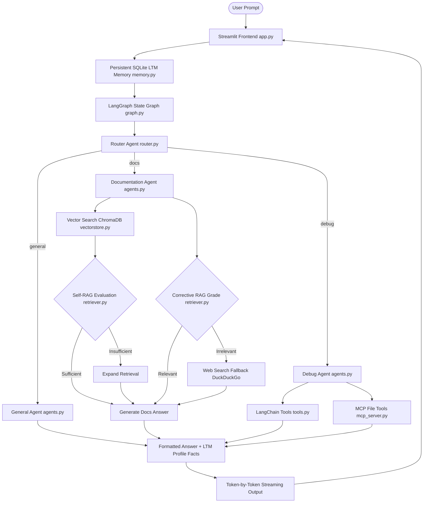

# 🤖 Developer AI Assistant

A complete, production-grade AI Assistant architecture built with **Streamlit**, **LangGraph**, **LangChain**, **Google Gemini**, **Persistent Long-Term Memory (SQLite LTM)**, **ChromaDB**, **Self-RAG (SRAG)**, **Corrective RAG (CRAG)**, **Web Search Fallback**, **Inline Citations**, **Agent Reasoning Traces**, **Token Streaming**, **LangChain Tools**, and a **Python Model Context Protocol (MCP) Server**.

---

## 🏗️ Architecture & Workflow



---

## 📁 Project Structure

```
developer_ai/
│
├── app.py              # Streamlit UI, LTM inspector, streaming & reasoning traces
├── memory.py           # SQLite Persistent Long-Term Memory (LTM) database manager
├── graph.py            # LangGraph workflow, LTM state persistence & CRAG web search
├── state.py            # GraphState TypedDict (LTM Facts, Memory, Traces, Citations)
├── agents.py           # General, Docs & Debug agents with LTM facts extraction
├── router.py           # Router Agent LLM classification logic
├── tools.py            # Tools (Calculator, Time, File Reader, Exec, Web Search)
├── retriever.py        # Vector search, Self-RAG, CRAG & Web Search Fallback
├── embeddings.py       # HuggingFace SentenceTransformer embeddings factory
├── vectorstore.py      # ChromaDB persistent store & PDF ingestion engine
├── prompts.py          # Standardized System Prompts & LTM templates
├── config.py           # Centralized configuration & Gemini LLM factory
├── mcp_server.py       # Python Model Context Protocol (MCP) Server
├── tests/
│   └── test_pipeline.py # Pytest automated test suite (LTM & Graph tests)
├── requirements.txt    # Project dependencies
├── .env.example        # Environment variable template
└── README.md           # Technical documentation
```

---

## ⚙️ Installation & Setup

### 1. Clone & Set Up Virtual Environment
```bash
git clone <repository_url>
cd developer_ai
python -m venv .venv
# On Windows PowerShell:
.venv\Scripts\Activate.ps1
```

### 2. Install Dependencies
```bash
pip install -r requirements.txt
pip install duckduckgo-search pytest ddgs
```

### 3. Environment Variables
Create a `.env` file in the project root:
```env
GOOGLE_API_KEY=your_google_api_key_here
```

---

## 🧪 Running Unit Tests

Run the automated Pytest test suite:
```bash
pytest tests/test_pipeline.py
```

---

## 🚀 Running the Application

Launch the Streamlit interface:
```bash
streamlit run app.py
```
Open your browser at `http://localhost:8501`.

---

## 💡 Advanced Feature Highlights

1. 💾 **Persistent Long-Term Memory (LTM)**: Embedded SQLite database (`developer_ai_ltm.db`) automatically saves and restores full chat history and persistent user profile facts across server restarts.
2. 💭 **Agent Reasoning Traces**: Displays expandable step-by-step decision traces (`[Router]`, `[LTM Database]`, `[Retriever]`, `[Self-RAG]`, `[CRAG]`, `[Tool Execution]`).
3. ⚡ **Token-by-Token Streaming**: Streams response text dynamically using `st.write_stream`.
4. 🌐 **Web Search Fallback**: Automatically queries live web search when CRAG grades document context as `IRRELEVANT`.
5. 📌 **Inline Citations**: Attaches explicit `[Doc 1]`, `[Doc 2]`, or `[Web Search 1]` tags to referenced facts.
