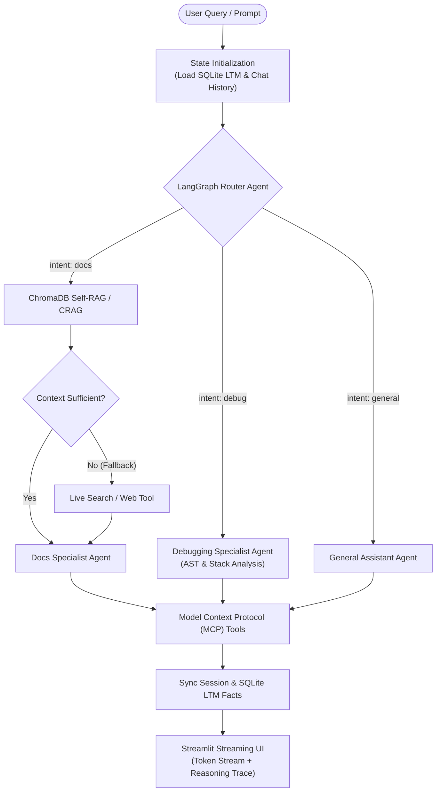

# Multi-Agent Developer Assistant (`developer_ai`)

[](LICENSE)
[](https://python.org)
[](https://langchain-ai.github.io/langgraph/)
[](https://langchain.com)
[](https://ai.google.dev/)
[](https://trychroma.com)
[](https://sqlite.org)
[](https://streamlit.io)
[](https://modelcontextprotocol.io)

An autonomous, multi-agent developer intelligence system that decouples complex software engineering queries into specialized agent execution paths. Features a **central LangGraph router agent**, **Self-RAG / Corrective RAG (CRAG) doc retriever**, **persistent SQLite long-term memory (LTM)**, an extensible **Model Context Protocol (MCP)** server, and a **Streamlit** user interface with token response streaming.

---

## 📌 Overview

Single-agent LLM systems struggle with complex software workflows that demand contradictory competencies: general conversational agility, precise documentation retrieval without hallucination, and rigorous code debugging. 

**Multi-Agent Developer Assistant** resolves this through an orchestrated state machine:
- **Router Agent**: Dynamically classifies intent and dispatches execution state to the appropriate specialist agent.
- **Documentation Agent**: Performs Self-RAG and Corrective RAG (CRAG) against a ChromaDB vector store, grading relevance and falling back to live web search when documents are insufficient.
- **Debug Agent**: Analyzes code syntax, logic errors, and stack traces with step-by-step diagnostic reasoning.
- **Persistent Long-Term Memory (LTM)**: Stores and recalls developer preferences, active tech stacks, and user facts across sessions using SQLite.
- **Extensible MCP Tools**: Implements the Model Context Protocol to execute standardized tools and system inspections.

---

## 🏗️ Architecture & Workflow



---

## 🚀 Key Features

- **Multi-Agent State Orchestration**: Built with LangGraph's cyclic state graphs, keeping message context clean and preventing cross-domain prompt pollution.
- **Self-RAG & Corrective RAG (CRAG)**: Retrieves code snippets and API references from ChromaDB, evaluates document relevance before generation, and triggers search fallback on low confidence.
- **Cross-Session SQLite Long-Term Memory**: Automatically parses and extracts user facts (preferred programming language, current project context) into SQLite, persisting developer profile state across reboots.
- **Model Context Protocol (MCP) Server**: Native implementation of the MCP specification (`mcp_server.py`) enabling external tool invocation.
- **Streaming Response & Reasoning Traces**: Real-time token streaming with collapsible expanders revealing the agent's step-by-step reasoning steps and citations.
- **Automated Test Suite**: Regression test pipeline (`tests/test_pipeline.py`) validating graph transitions and retrieval accuracy.

---

## 🛠️ Tech Stack

| Component | Technology |
| :--- | :--- |
| **Agent Framework** | LangGraph 1.2+, LangChain 1.3+ |
| **LLM Provider** | Google Gemini (`langchain-google-genai`) |
| **Vector Store** | ChromaDB (local persistence & dense semantic embeddings) |
| **Long-Term Memory** | SQLite3 relational database (`memory.py`) |
| **Tool Protocol** | Model Context Protocol (`mcp` Python SDK) |
| **User Interface** | Streamlit 1.60+ (SSE & Token-by-token streaming) |
| **Evaluation** | Pytest, unittest (`tests/test_pipeline.py`) |

---

## ⚙️ Environment Variables

Create a `.env` file in the root directory:

```bash
# Google Gemini API Key (Required)
GOOGLE_API_KEY=your_gemini_api_key_here

# Optional: Port configuration for MCP server
MCP_PORT=8080
```

---

## 🏁 Setup & Run Steps

### Prerequisites
- Python 3.10+
- Valid Google Gemini API Key

### 1. Clone & Setup Virtual Environment
```bash
git clone https://github.com/gagan05407/developer_ai.git
cd developer_ai

# Create virtual environment
python -m venv venv
# On Windows:
.\venv\Scripts\activate
# On Linux/macOS:
source venv/bin/activate

# Install dependencies
pip install -r requirements.txt
```

### 2. Configure Environment
```bash
cp .env.example .env
# Edit .env and supply your GOOGLE_API_KEY
```

### 3. Run the Streamlit Interface
```bash
streamlit run app.py
```
Access the application in your browser at `http://localhost:8501`.

### 4. (Optional) Run MCP Server Standalone
```bash
python mcp_server.py
```

### 5. Run Automated Tests
```bash
pytest tests/test_pipeline.py -v
```

---

## 📸 Screenshots

| Multi-Agent Routing & Chat | Reasoning Trace & Citations |
| :---: | :---: |
| *(Placeholder: Add `docs/screenshots/chat_stream.png`)* | *(Placeholder: Add `docs/screenshots/reasoning_trace.png`)* |

| ChromaDB RAG Inspection | SQLite Long-Term Memory View |
| :---: | :---: |
| *(Placeholder: Add `docs/screenshots/rag_retrieval.png`)* | *(Placeholder: Add `docs/screenshots/memory_viewer.png`)* |

---

## 🌐 Live Demo

- **Repository**: [https://github.com/gagan05407/developer_ai](https://github.com/gagan05407/developer_ai)
- **Live Streamlit App**: *(Add deployed Streamlit Community Cloud URL here)*

---

## 💡 What I Learned

- **LangGraph State Partitioning**: Learned how passing monolithic prompt histories across agents leads to context drift; resolved this by partitioning state attributes (`messages`, `user_facts`, `route`, `citations`) into a strictly typed `GraphState`.
- **Mitigating RAG Degradation**: Standard naive RAG often injects noisy documentation; implementing a Corrective RAG (CRAG) relevance grader prevented degraded LLM answers on ambiguous API queries.
- **MCP Integration**: Learned how the Model Context Protocol standardizes tool discovery and execution, enabling clean decoupling of host models from specialized local runtime tooling.
